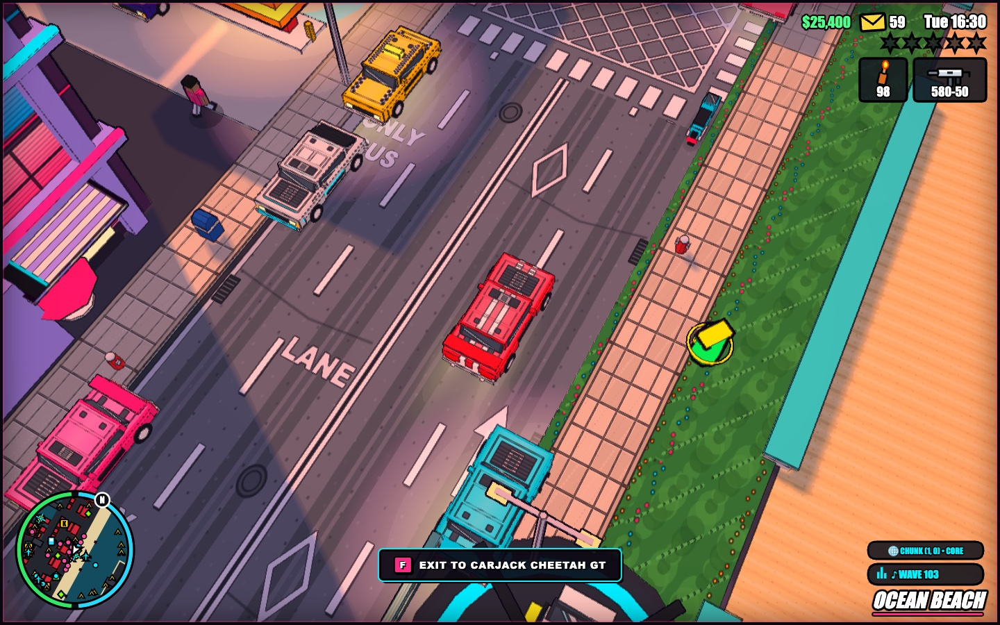

# Open City, a community instance by Vitalii Kuzminov

This repository is Vitalii Kuzminov's community instance of **Open City**, the cel-shaded 3D open-world action game Blend for ACRYL Blends.

- GitHub: <https://github.com/333icet333>
- Upstream Blueprint: `acrylblends.open-city`, <https://github.com/acrylblends/41-open-city>
- Registry: <https://acrylblends.github.io/blends>
- ACRYL Bootcamp, Vienna, 20 November 2026: <https://github.com/acrylworkshop/bootcamp-2026-11-20>

The app is the upstream Blueprint with its manifest id and name set for this instance. The README below is the upstream one, and the game's credits and licence are in `README.md`, `LICENSE` and `NOTICE`.
